<div align="center">



<br />

<a href="https://github.com/Tokyo-Jhx">
  
</a>

<p>
  
  
  
</p>

</div>

## 👾 Sobre mí · 自己紹介

Soy **Jhosep**, alias **TokyoDev**. Estudio Análisis y Desarrollo de Software en el SENA y me gusta construir cosas que funcionen de verdad: APIs, bots de Discord, apps de escritorio y uno que otro experimento raro.

```js
const tokyoDev = {
  nombre:     "Jhosep S.",
  alias:      ["TokyoDev", "Jhx"],
  estudio:    "Tecnólogo en ADSO @ SENA 🇨🇴",
  stack:      ["PHP", "Laravel", "C#", ".NET", "MySQL"],
  explorando: ["Flutter", "Blazor", "bots de Discord"],
  meta:       "Ingeniería en 2027 🎯",
  horario:    "mejor de noche 🌙",
};
```

## 🛠️ Tecnologías · 技術

<div align="center">

**Lo que uso**


**Lo que estoy aprendiendo y mis herramientas**


</div>

## 🚀 Proyectos · プロジェクト

| | Proyecto | De qué va | Stack |
|:-:|---|---|---|
| 🛡️ | [**JHX//CORE**](https://github.com/Tokyo-Jhx/JHXCORE) | Claude Code portátil para Windows, con tu cuenta protegida por un PIN | C# · WPF |
| 📇 | [**Contact API**](https://github.com/Tokyo-Jhx/Contact-Api-Jhosep) | API REST de contactos: cada usuario entra con token y ve solo lo suyo | Laravel 13 · PHP 8.4 |
| ✅ | [**TaskFlow API**](https://github.com/Tokyo-Jhx/taskflow-api) | API REST para gestionar tareas | Laravel |
| 🏦 | [**Banco ADSO**](https://github.com/Tokyo-Jhx/Banco-ADSO) | Proyecto bancario del programa ADSO | PHP · MySQL |

## 📊 Estadísticas · 統計

<div align="center">


</div>

<div align="center">

<picture>
  <source media="(prefers-color-scheme: dark)" srcset="https://raw.githubusercontent.com/Tokyo-Jhx/Tokyo-Jhx/output/snake-tokyo-dark.svg" />
  <source media="(prefers-color-scheme: light)" srcset="https://raw.githubusercontent.com/Tokyo-Jhx/Tokyo-Jhx/output/snake-tokyo-light.svg" />
  
</picture>

<br /><br />


</div>
